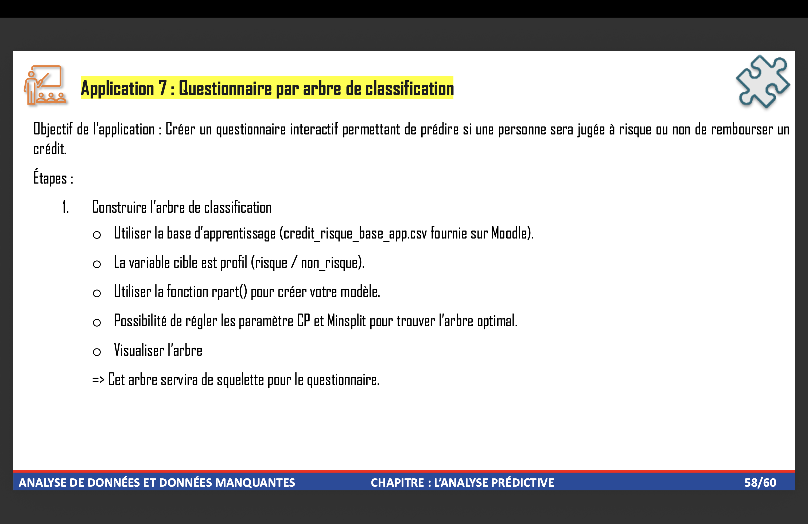
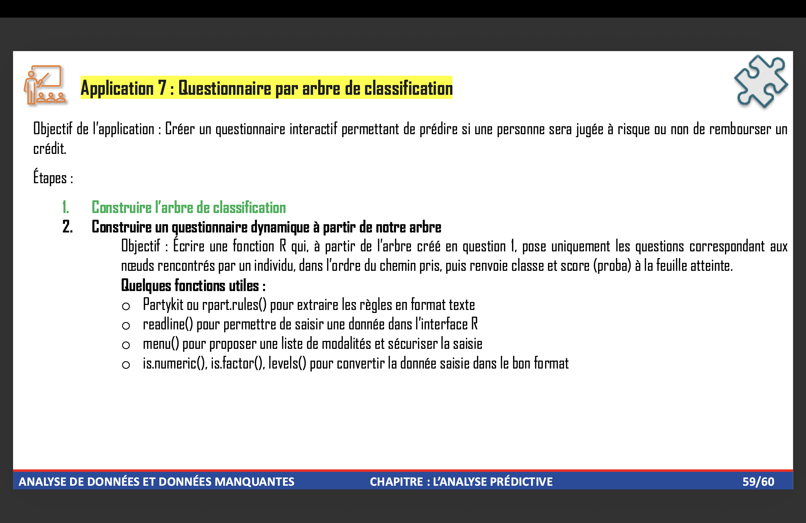

```{r, echo=FALSE, out.width="60%", fig.align="center"}

```

 


```{r, echo=FALSE, out.width="60%",fig.align="center"}
knitr::include_graphics("Idée d'amélioration.png")
```

```{r}
# Installation des packages

install.packages("rpart")
library(rpart)
library(rpart.plot)
```


```{r}
# Importation des données : credit risque base app
Credit <- read.csv2("credit risque base app.csv")

# Affichage des données
head(Credit)

# Convertion des caratères et certaines variables en facteurs
Credit[sapply(Credit, is.character)] <- lapply(Credit[sapply(Credit, is.character)], as.factor)
Credit$nb_enfants <- as.factor(Credit$nb_enfants)

# Resumés statistique
summary(Credit)
```
```{r}
nrow(Credit)
```


```{r}
# Creation de l'arbre de classification
tree.credit <- rpart(profil~., Credit, method = "class", cp =  0.014667 )
printcp(tree.credit)
```


```{r}
png("arbre_credit.png", width = 2400, height = 1400, res = 150)
par(mar=c(3,3,3,3))
plot(tree.credit, uniform = TRUE,  branch = 0.4, compress = TRUE)
text(tree.credit, use.n = TRUE, minlength = 100, cex= 0.5, all = TRUE)
dev.off()
```


```{r}
png("arbre_credit0.png", width = 2400, height = 1400, res = 150)
par(mar=c(3,3,3,3))
rpart.plot(tree.credit, extra = 2)
text(tree.credit, use.n = TRUE, minlength = 100, cex= 0.5, all = TRUE)
dev.off()
```


```{r}
plotcp(tree.credit)
```


```{r, echo=FALSE, out.width="60%", fig.align="center"}

```


```{r}
# Installation du packages : "partykit".
install.packages("partykit")
library(partykit)
```


```{r}
# Étape 1 — Convertir l'arbre en objet "party"
arbre.party <- as.party(tree.credit)
arbre.party
```
```{r}
# Étape 2 — Explorer la structure d'un nœud
noeud <- arbre.party[[1]]  # nœud racine
noeud$node$split           # infos sur le split de ce nœud
noeud$node$split$varid     # identifiant de la variable testée
```

```{r}
# Sur le nœud posant la question "type_contrat".

noeud_test <- arbre.party[[1]]  # adapte l'indice si ce n'est pas la racine
noeud_test$node$split$varid
names(Credit)[noeud_test$node$split$varid]
levels(Credit$type_contrat)
noeud_test$node$split$index

names(model.frame(tree.credit))[10]
levels(model.frame(tree.credit)[[10]])

```
```{r}
noms_variables <- names(data_party(arbre.party))
noms_variables[10]
levels(data_party(arbre.party)[[10]])
```


# Verification 

```{r}
library(partykit)

# Nœud racine
id_racine <- 1

# Récupérer les enfants du nœud racine
enfants <- kids_node(node_party(arbre.party))
id_enfant_gauche <- id_node(enfants[[1]])
id_enfant_droit <- id_node(enfants[[2]])

id_enfant_gauche
id_enfant_droit
```

 
 


```{r}
# Étape 3 — Écrire la fonction de navigation

predire_interactif <- function(arbre, data_originale) {
  noeud <- node_party(arbre)
  
  while (length(kids_node(noeud)) > 0) {
    split <- noeud$split
    varid <- split$varid
    nom_var <- names(data_originale)[varid]
    var_data <- data_originale[[nom_var]]
    
     if (is.numeric(var_data)) {
  seuil <- split$breaks
  reponse <- as.numeric(readline(paste0(nom_var, " (numérique) ? ")))
  
  va_a_droite <- if (isTRUE(split$right)) reponse > seuil else reponse >= seuil
  direction <- if (va_a_droite) 1 else 2
} else if (is.factor(var_data)) {
      niveaux <- levels(var_data)
      choix <- menu(niveaux, title = paste("Choisissez", nom_var))
      reponse <- niveaux[choix]
      index_gauche <- split$index
      direction <- index_gauche[which(niveaux == reponse)]
    }
    
    enfants <- kids_node(noeud)
    noeud <- enfants[[direction]]
  }
  
  id_feuille <- id_node(noeud)
  
  # Récupération des observations d'apprentissage tombées dans cette feuille
  donnees_ajustees <- fitted(arbre)
  ids_par_obs <- donnees_ajustees[["(fitted)"]]
  reponses_par_obs <- donnees_ajustees[["(response)"]]
  
  reponses_feuille <- reponses_par_obs[ids_par_obs == id_feuille]
  effectifs <- table(reponses_feuille)
  probas <- prop.table(effectifs)
  
  cat("Classe prédite :", names(which.max(effectifs)), "\n\n")
  for (i in seq_along(effectifs)) {
    cat(names(effectifs)[i], " -> effectif :", effectifs[i], 
        " | probabilité :", round(probas[i], 3), "\n")
  }
}
```


```{r}
# Étape 4 — Utiliser la fonction
predire_interactif(arbre.party, data_party(arbre.party))
```


# Arbre Interactive sur Shiny


$\ Shiny$ fournit le cadre neccessaire pour remplacer $\ readline()$ / $\ menu() $ par des vrais consoles web.
```{r}
install.packages("shiny")
library(shiny)
```


```{r}
install.packages("visNetwork")
library(visNetwork)
```

** Construction
```{r}
 construire_arbre_visuel <- function(party_obj) {
  nodes_list <- list()
  edges_list <- list()
  
  recurse <- function(n) {
    id <- id_node(n)
    kids <- kids_node(n)
    
    if (length(kids) == 0) {
      donnees <- fitted(party_obj)
      reponses <- donnees[["(response)"]][donnees[["(fitted)"]] == id]
      effectifs <- table(reponses)
      classe <- names(which.max(effectifs))
      label <- paste0(
        classe, "\n",
        paste(names(effectifs), effectifs, sep = ": ", collapse = "\n")
      )
      
      couleur_feuille <- if (classe == "non_risque") "#C6E6C6" else "#F2C6C6"
      
      nodes_list[[length(nodes_list)+1]] <<- data.frame(
        id = id, label = label, shape = "box", color = couleur_feuille
      )
    } else {
      split <- n$split
      varid <- split$varid
      nom_var <- names(data_party(party_obj))[varid]
      var_data <- data_party(party_obj)[[nom_var]]
      
      nodes_list[[length(nodes_list)+1]] <<- data.frame(
        id = id, label = nom_var, shape = "ellipse", color = "#F5E0C0"
      )
      
      if (is.numeric(var_data)) {
        seuil <- split$breaks
        droite_stricte <- isTRUE(split$right)
        label_g <- if (droite_stricte) paste("<=", seuil) else paste("<", seuil)
        labels_branches <- c(label_g, "")
      } else {
        niveaux <- levels(var_data)
        groupe_g <- niveaux[split$index == 1]
        labels_branches <- c(paste(groupe_g, collapse = ", "), "")
      }
      
      for (i in seq_along(kids)) {
        child_id <- id_node(kids[[i]])
        edges_list[[length(edges_list)+1]] <<- data.frame(
          from = id, to = child_id, label = labels_branches[i],
          id = paste0(id, "-", child_id)
        )
        recurse(kids[[i]])
      }
    }
  }
  
  recurse(node_party(party_obj))
  list(nodes = do.call(rbind, nodes_list), edges = do.call(rbind, edges_list))
}

elements_arbre <- construire_arbre_visuel(arbre.party)
        
      
```


**  Structure du $\ ui$ : Il faut remplir le conteneur $\ uiOutput$ que le serveur remplit question par question. $\ plotOutput("arbre\_plot")$ : affiche l'arbre complet.$\ uiOutput("question\_dynamique")$ : emplacement vide, rempli dynamiquement par le serveur. $\ verbatimTextOutput("resultat")$ : affiche classe/effectifs/probabilités .
```{r}
ui <- fluidPage(
  titlePanel("Questionnaire de risque crédit"),
  sidebarLayout(
    sidebarPanel(
      width = 3,
      uiOutput("question_dynamique"),
      actionButton("valider", "Valider"),
      br(), br(),
      actionButton("recommencer", "Recommencer"),
      hr(),
      verbatimTextOutput("resultat")
    ),
    mainPanel(
      width = 9,
      visNetworkOutput("arbre_plot", height = "850px")
    )
  )
)
```


** Structure du $\ server$ : 
```{r}
server <- function(input, output, session) {
  
  id_racine <- id_node(node_party(arbre.party))
  etat <- reactiveValues(
    noeud = node_party(arbre.party),
    chemin = id_racine
  )
  
  output$question_dynamique <- renderUI({
    if (length(kids_node(etat$noeud)) == 0) return(NULL)
    
    split <- etat$noeud$split
    nom_var <- names(data_party(arbre.party))[split$varid]
    var_data <- data_party(arbre.party)[[nom_var]]
    
    if (is.numeric(var_data)) {
      numericInput("reponse_num", paste(nom_var, "?"), value = 0)
    } else {
      selectInput("reponse_fac", paste("Choisissez", nom_var), choices = levels(var_data))
    }
  })
  
  observeEvent(input$valider, {
  if (length(kids_node(etat$noeud)) == 0) return()
  
  split <- etat$noeud$split
  varid <- split$varid
  nom_var <- names(data_party(arbre.party))[varid]
  var_data <- data_party(arbre.party)[[nom_var]]
  
  if (is.numeric(var_data)) {
    direction <- if (input$reponse_num <= split$breaks) 1 else 2
  } else {
    niveaux <- levels(var_data)
    direction <- split$index[which(niveaux == input$reponse_fac)]
  }
  
  nouveau_noeud <- kids_node(etat$noeud)[[direction]]
  etat$noeud <- nouveau_noeud
  etat$chemin <- c(etat$chemin, id_node(nouveau_noeud))
})
  
  observeEvent(input$recommencer, {
    etat$noeud <- node_party(arbre.party)
    etat$chemin <- id_racine
  })
  
  output$arbre_plot <- renderVisNetwork({
  visNetwork(elements_arbre$nodes, elements_arbre$edges, width = "100%") %>%
    visHierarchicalLayout(direction = "UD", sortMethod = "directed",
                           levelSeparation = 180, nodeSpacing = 220, treeSpacing = 60) %>%
    visEdges(arrows = "to", color = list(color = "#B0B0B0"),
             font = list(size = 13, align = "middle")) %>%
    visNodes(font = list(size = 16), shape = "box",
             widthConstraint = list(minimum = 90, maximum = 220))
})
  observe({
    chemin <- etat$chemin
    if (length(chemin) < 2) return()
    
    pairs_from <- chemin[-length(chemin)]
    pairs_to <- chemin[-1]
    edge_ids <- paste0(pairs_from, "-", pairs_to)
    
    edges_update <- elements_arbre$edges
    edges_update$color.color <- ifelse(edges_update$id %in% edge_ids, "purple", "#B0B0B0")
    edges_update$width <- ifelse(edges_update$id %in% edge_ids, 5, 1)
    
    visNetworkProxy("arbre_plot") %>% visUpdateEdges(edges_update)
  })
  
  output$resultat <- renderText({
    if (length(kids_node(etat$noeud)) > 0) return("Réponds aux questions pour voir le résultat.")
    
    id_feuille <- id_node(etat$noeud)
    donnees <- fitted(arbre.party)
    reponses <- donnees[["(response)"]][donnees[["(fitted)"]] == id_feuille]
    effectifs <- table(reponses)
    probas <- prop.table(effectifs)
    
    paste0(
      "Classe prédite : ", names(which.max(effectifs)), "\n",
      paste(names(effectifs), "-> effectif:", effectifs, "| proba:", round(probas, 3), collapse = "\n")
    )
  })
}
```


```{r}
shinyApp(ui = ui, server = server)
```


